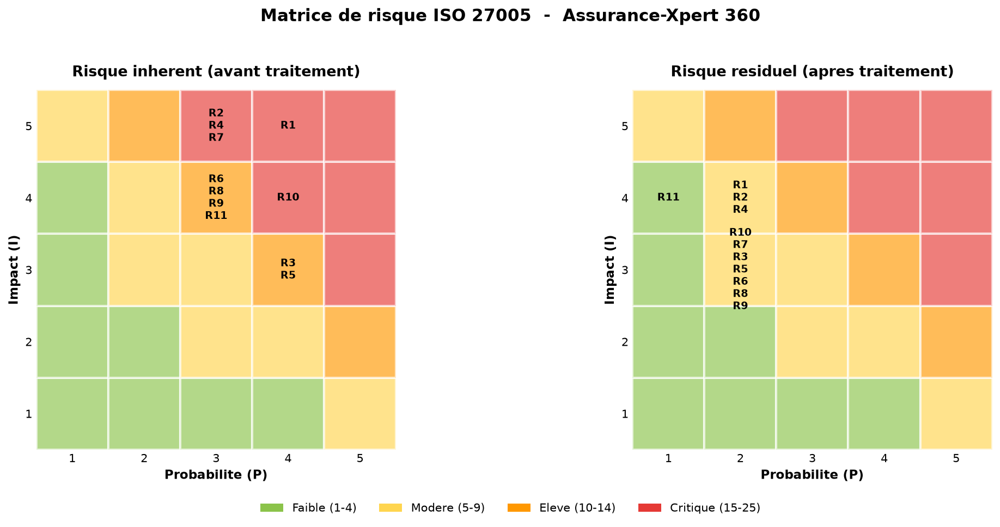

# Analyse de risque ISO/IEC 27005:2022 : CRM SaaS

> Étude de cas appliquée : appréciation et traitement des risques de sécurité liés à l'adoption d'une application CRM en mode SaaS, selon la démarche **ISO/IEC 27005:2022** et dans un cadre **SMSI (ISO/IEC 27001)**.


---

## ⚠️ Avertissement

Ce dépôt est un **exercice académique**. La société « Prévoria Assurances » et l'application « Assurance-Xpert 360 » sont **fictives**. Il ne s'agit **pas** de l'audit d'un système réel : aucune donnée, adresse, configuration ou vulnérabilité réelle n'y figure. L'objectif est de **démontrer une méthodologie d'analyse de risque**, pas d'évaluer un bien existant.

Le scénario d'origine a été fourni dans le cadre d'un cours de *Governance, Risk & Compliance*. Il est ici **reformulé** ([`docs/scenario.md`](docs/scenario.md)) ; les supports de cours originaux ne sont pas redistribués. L'analyse est un travail personnel.

---

## 🎯 Objet

La Direction commerciale de Prévoria Assurances (1000 salariés, assurance santé) remplace son ancien CRM interne par **Assurance-Xpert 360**, une solution SaaS hébergée sur Azure et exposée sur Internet, utilisée par ~250 collaborateurs. Le CRM devient l'outil central de la relation client : **~80 % de l'activité commerciale en dépendra**, et il traite des **données personnelles d'assurés** (RGPD).

L'analyse vise à :
1. apprécier les risques de sécurité liés à l'adoption du SaaS ;
2. vérifier les conditions d'une conformité RGPD ;
3. éclairer la Direction sur un déploiement maîtrisé.

## 🧭 Démarche

Processus **ISO/IEC 27005:2022** de bout en bout :

```
Établissement du contexte
        │
        ▼
Appréciation du risque ── Identification ── Analyse ── Évaluation ──► Point de décision 1
        │
        ▼
Traitement du risque (Modifier / Éviter / Partager / Conserver)
        │
        ▼
Acceptation ──► Point de décision 2
        │
        ▼
Communication & surveillance continue (PDCA)
```

- Approche **par les biens** (asset-based), cohérente avec un périmètre centré sur une application définie.
- Cotation : **Risque = Probabilité × Impact** sur une matrice **5×5** (1 à 25), avec seuils d'acceptation explicites définis *avant* l'appréciation.
- Valorisation des biens par **BIA** (impact Disponibilité / Intégrité / Confidentialité, valeur = max).
- Conséquences exprimées en **DICP** (Disponibilité, Intégrité, Confidentialité, Preuve).

## 📊 Résultats en synthèse

11 scénarios de risque identifiés. **Aucun n'est acceptable en l'état** : 5 critiques, 6 élevés. Après traitement, tous repassent sous le seuil critique (10 modérés, 1 faible).

| Rang | Risque | P×I | Niveau | Résiduel |
|------|--------|-----|--------|----------|
| 1 | R1 : Compromission d'un compte commercial (MFA absent) | 20 | 🔴 Critique | 8 (Modéré) |
| 2 | R10 : Non-conformité RGPD (sous-traitance) | 16 | 🔴 Critique | 6 (Modéré) |
| 3 | R2 : Abus du rôle Super Administrator | 15 | 🔴 Critique | 8 (Modéré) |
| 3 | R4 : Vol de la clé API (R/W sur l'ERP) | 15 | 🔴 Critique | 8 (Modéré) |
| 3 | R7 : Restauration non garantie | 15 | 🔴 Critique | 6 (Modéré) |
| … | R3/R5/R6/R8/R9/R11 (élevés) | 12 | 🟠 Élevé | ≤ 6 |



➡️ **Recommandation : déploiement sous conditions, en deux temps** : mesures rapides (MFA généralisé, nettoyage des comptes, TLS 1.2+, raccordement SIEM) puis chantiers de fond (secrets d'API, tests de restauration, PAM, cadre RGPD contractuel).

## 🗂️ Contenu du dépôt

| Chemin | Description |
|--------|-------------|
| [`docs/scenario.md`](docs/scenario.md) | Reformulation du cas d'étude |
| [`docs/architecture.md`](docs/architecture.md) | Architecture technique et flux |
| [`docs/risk-assessment.md`](docs/risk-assessment.md) | **Analyse complète** (contexte → traitement → acceptation → limites) |
| [`registers/risk-register.csv`](registers/risk-register.csv) | Registre des risques exploitable (CSV) |
| [`assets/`](assets/) | Matrice de risque / heatmap |

## 🛠️ Compétences démontrées

Gouvernance & analyse de risque (ISO 27005 / 27001) · BIA & valorisation d'actifs · modélisation de scénarios de menace · cotation et priorisation · plan de traitement et risque résiduel · RGPD (art. 28, DPA, AIPD) · sécurité SaaS / cloud (IAM, API, SIEM, PRA) · modèle de responsabilité partagée.

## 📄 Licence

Voir [`LICENSE`](LICENSE).
