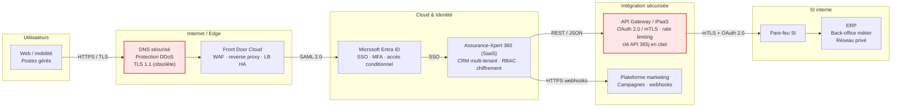

# Architecture technique et flux

L'architecture annoncée est globalement saine (Zero Trust, SSO, WAF, chiffrement). L'analyse de risque porte sur les **écarts de mise en œuvre et de gouvernance**, pas sur le principe de l'architecture.

## Contrôles transverses annoncés

- **Zero Trust**, moindre privilège, gestion des secrets, chiffrement en transit et au repos.
- **Exploitation & résilience** : logs centralisés, SIEM/SOC, alerting, audit API, sauvegarde / PRA, haute disponibilité et tests de reprise.

## Écarts relevés par rapport à l'architecture cible

| Contrôle annoncé | Écart constaté | Risque associé |
|------------------|----------------|----------------|
| MFA / accès conditionnel | MFA non imposé aux commerciaux ; 23 comptes dormants | R1, R3 |
| Moindre privilège | 3 Super Admins ; droits auto-attribués ; 15 comptes locaux | R2, R3 |
| Gestion des secrets | Clé API en clair, 365 j, partagée, R/W | R4 |
| SIEM / SOC | Logs SaaS non raccordés, SOC aveugle sur le SaaS | R5 |
| Sauvegarde / PRA testé | RPO/RTO non contractualisés, aucun test de restauration | R6, R7 |
| Chiffrement en transit | TLS 1.1 (déprécié) sur l'accès Internet | R11 |
| Encadrement fournisseur | Accès support sans visibilité ; 4 sous-traitants | R8, R9, R10 |
